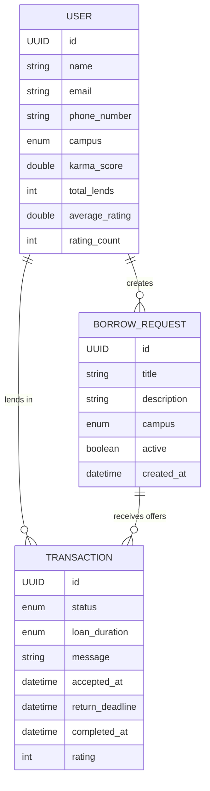

# CampusLend

A peer-to-peer lending platform for university students. Students post what they need to borrow (a calculator, a charger, a lab coat), other students on the same campus offer to lend it, and a karma-based reputation system rewards people who help.

> **Status: work in progress.** The data layer is done. The REST endpoints, authentication and scheduled jobs are in development, and a React frontend will follow.

## How it works

1. A student creates a **borrow request** for an item on their campus.
2. Other students on the same campus see it in a **feed**, which can be searched and is ranked by the requester's karma score.
3. Lenders send **offers** with a message and a loan duration (a few hours, one day, three days or one week).
4. The requester accepts one offer. The other pending offers for that request are updated automatically.
5. When the item is returned, the transaction is completed. The lender earns **karma points** and can receive a **1–5 star rating**.
6. Loans that pass their return deadline can be detected as overdue, and karma scores **decay over time**, so the ranking reflects recent activity.

## Tech stack

- **Java 21**, **Spring Boot 4**
- **Spring Data JPA / Hibernate** with **PostgreSQL**
- **Spring Security** (in progress), **Jakarta Bean Validation**
- **MapStruct** for entity ↔ DTO mapping, **Lombok**
- **Maven**

## Data model



A transaction moves through these statuses: `PENDING`, `ACCEPTED`, `REJECTED`, `COMPLETED`, `CANCELLED` and `EXPIRED`.

## Engineering highlights

- **No N+1 queries:** the feed, inbox and history queries use `JOIN FETCH` to load related entities in a single query. The feed is paginated, with a separate count query.
- **Bulk updates in the database:** karma rewards, rating averages and karma decay run as single `UPDATE` statements instead of loading and saving entities one by one.
- **Optimistic locking:** `@Version` on requests and transactions prevents two users from overwriting each other's changes, for example when two offers are accepted at the same time.
- **Indexes** on the columns used to filter the feed (`campus`, `active`, `requester_id`).
- **Validated request DTOs** (Java records with Bean Validation) and **MapStruct** mappers keep entities out of the API layer.
- **Centralized error handling:** a global exception handler returns RFC 9457 `ProblemDetail` responses, including per-field validation errors.
- **`open-in-view` disabled**, so all data loading happens explicitly in the service layer.
- **No secrets in the code:** database credentials come from environment variables.

## Roadmap

- [x] Entities, enums and relationships
- [x] Repositories with custom JPQL queries
- [x] Request and response DTOs with validation
- [x] MapStruct mappers
- [x] Custom exceptions and global error handling
- [ ] Service layer with the business rules
- [ ] REST controllers
- [ ] Authentication with Spring Security
- [ ] Scheduled jobs for karma decay and overdue loans
- [ ] Unit and integration tests
- [ ] API documentation with OpenAPI / Swagger UI
- [ ] Docker Compose setup
- [ ] React frontend

## Running locally

Requirements: **Java 21** and **PostgreSQL**.

1. Create a database named `campuslend`.
2. Set the database credentials as environment variables:
   ```bash
   export DB_USER=your_user
   export DB_PASSWORD=your_password
   ```
3. Start the application from the `backend` folder:
   ```bash
   ./mvnw spring-boot:run
   ```

## Project structure

```
backend/src/main/java/com/campuslend/backend/
├── entity/        # JPA entities and enums
├── repository/    # Spring Data repositories and JPQL queries
├── dto/           # request and response records
├── mapper/        # MapStruct mappers
└── exception/     # custom exceptions and the global exception handler
```
